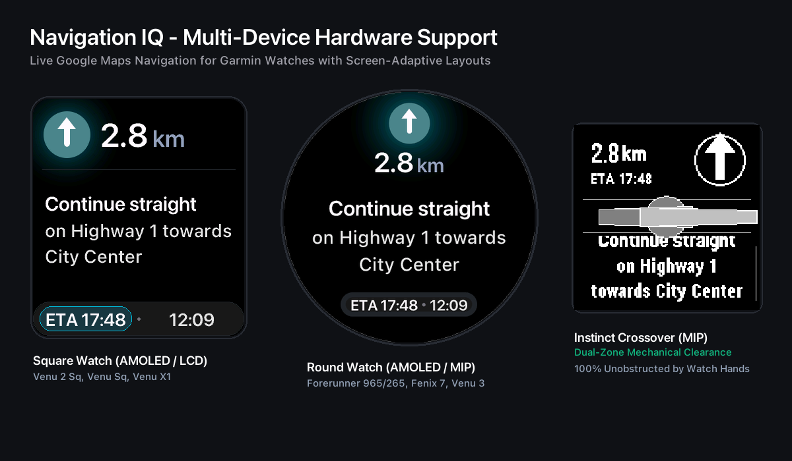
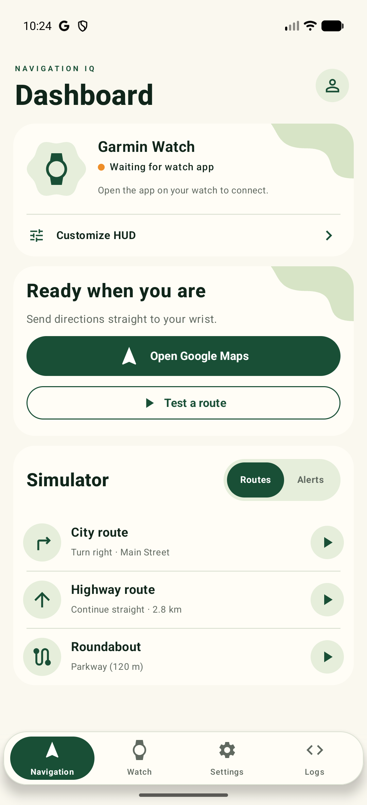
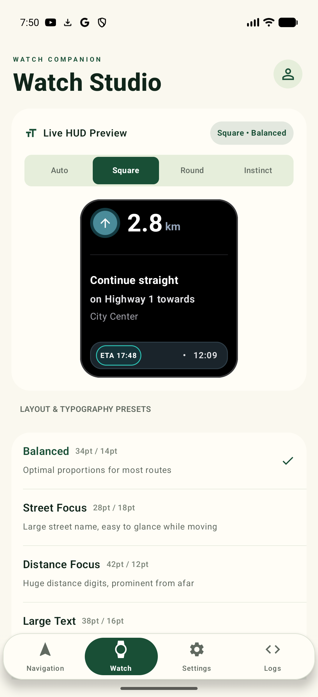
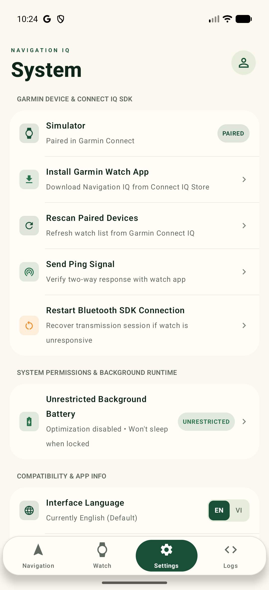
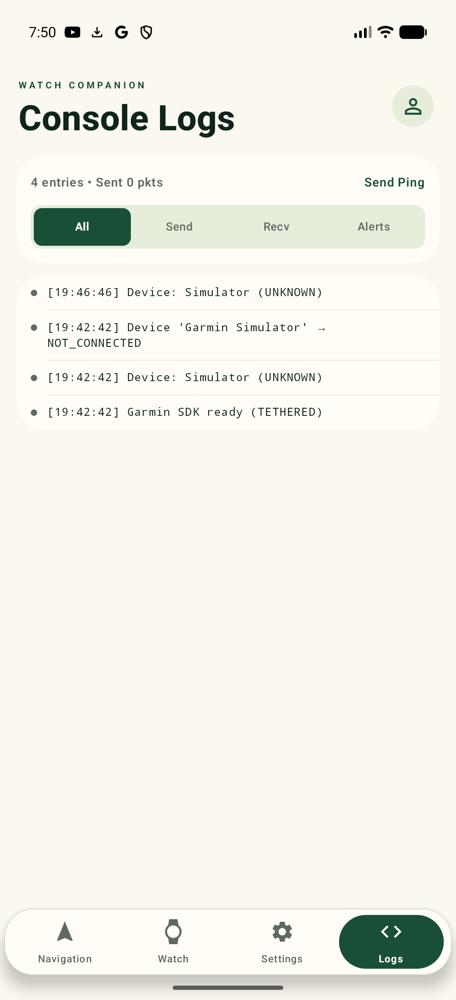
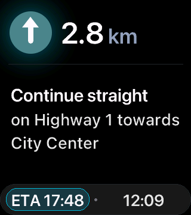
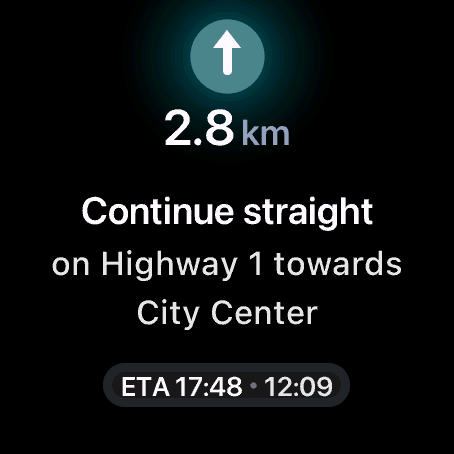

# Navigation IQ (NavIQ)

> **Navigation IQ** is a smart turn-by-turn navigation bridge connecting **Android (Jetpack Compose + Kotlin)** smartphones with **Garmin (Monkey C - Connect IQ)** smartwatches, supporting diverse screen form factors ranging from Square AMOLED and Round AMOLED/MIP to Dual-Zone MIP displays.



---

## Android App Showcase

The Android application is built with modern **Jetpack Compose**, delivering an intuitive, fluid, and minimalist user experience:

| Dashboard | Watch Studio |
| :---: | :---: |
|  |  |
| **Tab 0: Dashboard & Simulator**<br>Monitor Garmin watch connection status, launch navigation, and simulate test routes | **Tab 1: Watch Studio**<br>Real-time Live HUD Preview and layout typography presets |

| System Settings | Console Logs |
| :---: | :---: |
|  |  |
| **Tab 2: System Settings**<br>Manage Connect IQ SDK pairing, watch app installation, and background battery optimization | **Tab 3: System Logs**<br>Inspect BLE transmission packets and verify two-way diagnostics |

---

## Garmin Watch HUD Showcase (Adaptive Layouts)

The Connect IQ watch app is individually optimized for each Garmin hardware display category:

| Square AMOLED (Venu Sq 2) | Round AMOLED / MIP (FR965, Fenix 7) | Instinct Crossover (Dual-Zone MIP) |
| :---: | :---: | :---: |
|  |  |  |
| Optimized for square aspect ratio with large, prominent distance typography | Symmetrical radial layout with center-focused readability for running and cycling | Dual-zone partitioning engineered to prevent physical watch hands obstruction |

---

## Project Overview

Navigation IQ integrates two core architectural pillars:
1. **HUD Navigation Relay:** Transmits real-time turn instructions (direction arrow icons, remaining distance, street names, ETA) to Garmin watch faces via Bluetooth Low Energy using the Garmin Connect IQ Mobile SDK.
2. **Screen-Adaptive Engine:** Dynamically detects display geometries (Square, Round, Instinct Dual-Zone) and applies tailored typography presets for optimal glanceability while in motion.

---

## Project Architecture & Directory Structure

```text
NavigationIQ/
├── README.md                                    # Architecture overview and documentation
├── screenshots/                                 # Showcase banner and Android / Garmin exhibits
│   ├── 00_navigation_iq_showcase_banner.png
│   ├── 01_venu_sq2_square_hud.png
│   ├── 02_fr965_fenix7_round_hud.png
│   ├── 03_instinct_crossover_dualzone_hud.png
│   ├── 05_android_tab_navigation.png
│   ├── 06_android_tab_watch_studio.png
│   ├── 07_android_tab_settings.png
│   └── 08_android_tab_logs.png
├── app/                                         # Android App (Kotlin + Jetpack Compose)
│   ├── build.gradle.kts
│   └── src/main/
│       ├── AndroidManifest.xml
│       └── java/
│           ├── com/garmin/android/connectiq/    # Garmin ConnectIQ Mobile SDK
│           └── com/phucdnh/navigationiq/
│               ├── MainActivity.kt              # Jetpack Compose UI (4 Tabs, Liquid Sliding Indicator)
│               ├── model/
│               │   └── NavigationInfo.kt        # Navigation data model & RLE encoder
│               └── garmin/
│                   ├── GarminMessage.kt         # Diff cache & packet serialization
│                   └── GarminManager.kt         # ConnectIQ SDK lifecycle management
└── garmin_app/                                  # Garmin Connect IQ Watch App (Monkey C)
    ├── manifest.xml
    └── source/
        ├── NavigationIQApp.mc                   # Lifecycle & Connect IQ App Entry
        ├── NavigationIQView.mc                  # Layout renderer (Adaptive Square / Round / Instinct)
        └── NavigationIQDelegate.mc              # Physical key and touch gesture handlers
```

---

## Build & Installation Guide

### 1. Android App
- Requirements: Android Studio Jellyfish or newer, JDK 17.
- Build & install via PowerShell script:
  ```powershell
  powershell -ExecutionPolicy Bypass -File .vscode/run_android.ps1
  ```

### 2. Garmin Watch App
- Requirements: Garmin Connect IQ SDK 7.x or newer.
- Supported devices: Venu Sq 2, Venu Sq 2 Music, Forerunner 965, Forerunner 265, Fenix 7 series, Instinct Crossover.
- Build & run in simulator:
  ```powershell
  powershell -ExecutionPolicy Bypass -File .vscode/run_garmin.ps1
  ```


